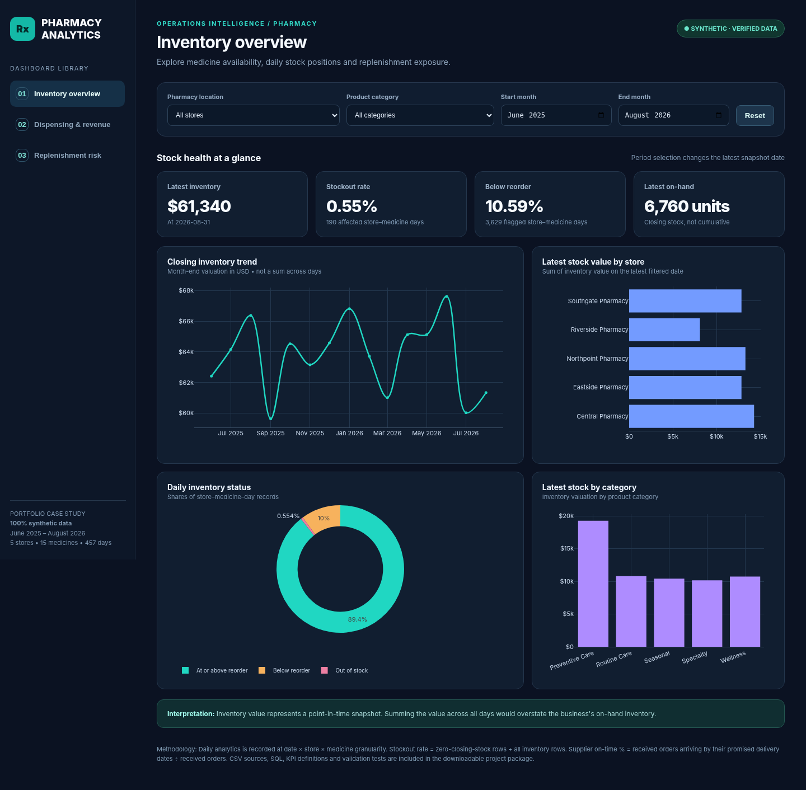
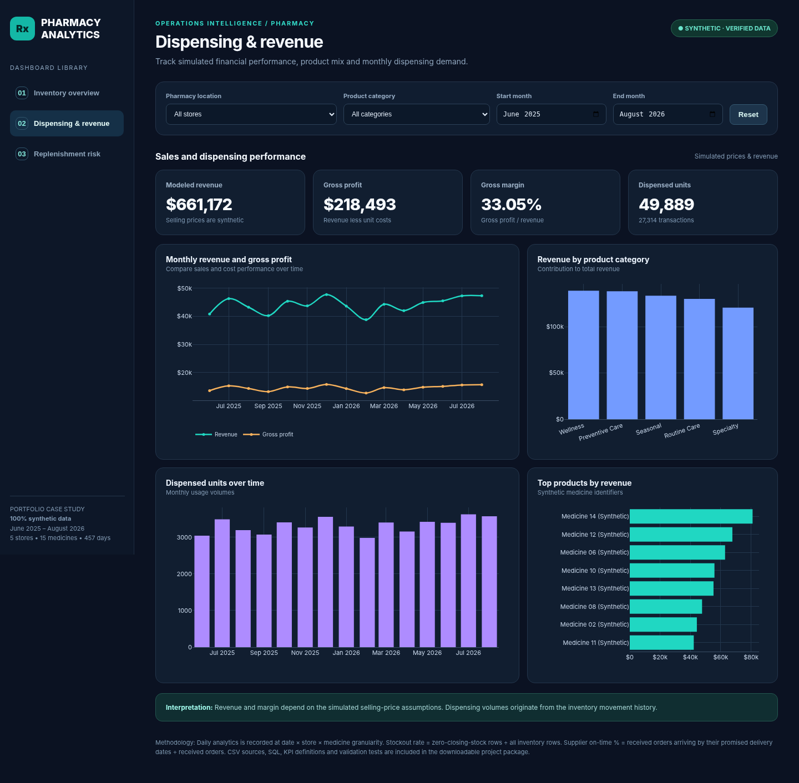
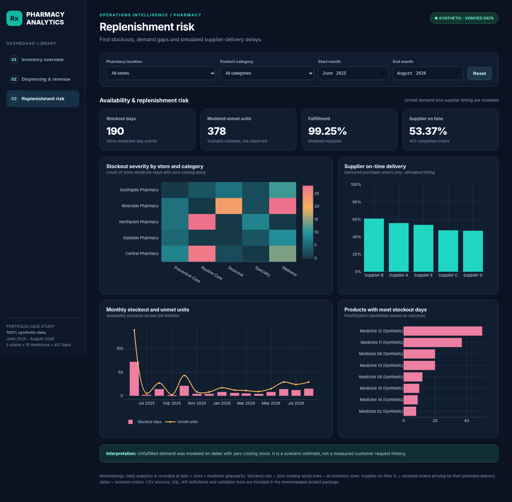

# 💊 PharmaPulse — Pharmacy Inventory & Dispensing Analytics

**An End-to-End Data Analytics Project Using Python, SQL, Tableau, and Plotly**

**🛠️ Technologies:** Python | SQL | SQLite | Tableau Public | Plotly  
**📅 Project Period:** June 2025 – August 2026  
**📁 Dataset:** Synthetic Pharmacy Operations Data

## 📌 About the Project

PharmaPulse is a data analytics project I developed to understand how pharmacies can use data to manage their daily operations more effectively.

Pharmacies deal with inventory, medicine dispensing, sales, and supplier deliveries every day. Keeping track of all this information can be challenging, especially when the data comes from different sources.

I wanted to understand how these activities are connected and how analyzing them together could help identify potential business problems.

For this project, I worked with 15 months of simulated data from five pharmacy locations. I used Python to prepare and validate the datasets, SQL to answer business questions, and Tableau and Plotly to visualize the results.

My main focus was to understand sales performance, identify stock shortages, analyze medicine demand, and evaluate supplier delivery performance.

## 🚀 Live Dashboards

### 📊 Tableau Public — Sales & Dispensing Analytics

**[View My Tableau Dashboards](https://public.tableau.com/app/profile/chandana.seelam/viz/PharmaPulse-PharmacySalesDispensingAnalytics/03StoreandCategoryInsights)**

**[Download Tableau Workbook (.twbx)](tableau/PharmaPulse%20-%20Pharmacy%20Sales%20%26%20Dispensing%20Analytics.twbx)**

I created three dashboards in Tableau Public to explore different aspects of pharmacy sales and dispensing activity.

**1. Executive Sales Overview**

This dashboard provides an overall picture of pharmacy sales, including revenue, gross profit, transactions, and units dispensed. I also included monthly trends to understand how sales performance changed over time.

**2. Dispensing and Demand**

Here, I focused on how dispensing activity and transactions varied across different months. This helped me explore medicine demand patterns in the simulated data.

**3. Store and Category Insights**

This dashboard compares pharmacy locations and product categories based on their revenue and profit contributions.

### 🌐 Interactive Pharmacy Analytics — Python & Plotly

**[Launch the Live PharmaPulse Dashboard](https://chandanaseelam.github.io/PharmaPulse-Pharmacy-Intelligence-Analytics/)**

Along with Tableau, I developed an interactive HTML dashboard using Python and Plotly.

It includes three views:

- **📦 Inventory Overview:** Shows stock availability, reorder levels, low-stock conditions, and stockout patterns.
- **💰 Dispensing & Revenue Analytics:** Explores transactions, sales, profit, and performance across stores.
- **🚚 Supply & Replenishment Risk:** Looks at purchase orders, supplier deliveries, and unmet medicine demand.

I added filters so users can explore the data by store, product category, and reporting period.

## 🎯 Business Questions I Wanted to Answer

Before starting the analysis, I identified the main questions I wanted to investigate.

1. Which pharmacies experience the most stock shortages?
2. How often do medicines fall below their reorder levels?
3. How do sales, profit, and dispensing activity change over time?
4. Which pharmacy locations contribute the most to revenue?
5. Are suppliers delivering orders within their expected timelines?
6. How much medicine demand is being fulfilled?

These questions helped me decide which datasets to use, what calculations to perform, and which dashboards to develop.

## 🔄 How I Worked on the Project

### 🐍 Data Preparation

I started by working with synthetic datasets containing medicine details, dispensing transactions, inventory records, supplier information, and purchase orders.

Using Python, I prepared the data, checked its consistency, and validated the records before starting the analysis.

### 🗄️ SQL Analysis

I used SQL to work with the different pharmacy datasets and answer business questions.

I practiced joins, filtering, aggregations, and calculations to analyze revenue, dispensing activity, inventory availability, and supplier performance.

### 📐 KPI Calculations

After preparing the data, I calculated the key metrics needed to understand pharmacy performance.

These included revenue, gross profit, profit margin, dispensed units, stockout occurrences, reorder warnings, and demand fulfillment.

### 📊 Dashboard Development

I used Tableau Public to create dashboards for sales and dispensing analysis.

I also developed a separate Plotly application to explore inventory conditions, revenue performance, and supplier-related risks.

### ✅ Data Validation and Publishing

I used Python scripts to check data consistency and validate the analytical results. The project includes 21 completed validation checks.

Finally, I published the Tableau dashboards on Tableau Public and hosted the Plotly application using GitHub Pages.

## 📈 Key Results

| Business Metric | Result |
|---|---:|
| Total Transactions | 27,314 |
| Units Dispensed | 49,889 |
| Total Revenue | $661,172.04 |
| Gross Profit | $218,493.34 |
| Gross Profit Margin | 33.05% |
| Daily Inventory Records | 34,275 |
| Stockout Store–Medicine–Days | 190 |
| Below-Reorder Store–Medicine–Days | 3,629 |
| Demand Fulfillment Rate | 99.25% |
| Supplier On-Time Delivery Rate | 53.37% |

All figures represent simulated pharmacy activity.

## 🔍 What I Discovered

### 📦 Inventory Availability

One of the main things I noticed was that low-stock conditions occurred much more frequently than complete stockouts.

The analysis identified 3,629 below-reorder records compared with 190 zero-stock records.

Riverside Pharmacy also had the highest stockout exposure among the five locations.

This showed me why pharmacies should monitor low-stock conditions rather than waiting until medicines run out.

### 💰 Sales Performance

The simulated pharmacy operations generated approximately $661K in revenue, with a gross profit margin of 33.05%.

Northpoint generated the highest revenue, while Riverside had relatively strong sales but also the most stockout occurrences.

This helped me understand that looking at revenue alone doesn't tell the whole story about how a pharmacy is performing.

### 💊 Demand Fulfillment

The dataset showed that 99.25% of requested medicine units were fulfilled.

Although the overall fulfillment rate was high, some simulated demand remained unmet.

This highlighted the importance of reviewing inventory availability alongside dispensing activity.

### 🚚 Supplier Performance

I also analyzed purchase orders and supplier delivery timelines.

The overall simulated on-time delivery rate was 53.37%.

This suggested that supplier delivery performance was an important area to investigate when reviewing replenishment planning.

These findings are based on generated data, so they represent analytical scenarios rather than actual business performance.

**[Read My Detailed Business Findings & Recommendations](analysis/Business_Findings.md)**

## 🖼️ Dashboard Gallery

### 📦 Inventory Overview



### 💰 Dispensing & Revenue Analytics



### 🚚 Supply & Replenishment Risk



These screenshots are from the Plotly application. My Tableau dashboards are available through the Tableau Public link above.

## 🐍 Python Business Analysis

In addition to the interactive dashboards, I used Python to create separate charts for some of the business findings.

These charts cover stockout exposure across stores, inventory warning conditions, supplier performance, revenue comparisons, and monthly trends.

The chart-generation script is included in the repository so the analysis can be reproduced using the project data.

**[View Python Analysis Script](scripts/create_business_findings_charts.py)**

**[View Google Colab Notebook](notebooks/PharmaPulse_Business_Findings_Colab.ipynb)**

## 🛠️ Tools I Used

| Tool | Purpose |
|---|---|
| Python | Data preparation, validation, and analysis |
| Pandas | Data manipulation and calculations |
| SQL | Business queries and aggregations |
| SQLite | Storing and querying related datasets |
| Tableau Public | Sales and dispensing dashboards |
| Plotly | Interactive pharmacy dashboards |
| Matplotlib | Business findings visualizations |
| Google Colab | Running and exploring Python analysis |
| GitHub | Project documentation and source code |
| GitHub Pages | Hosting the interactive dashboard |

## 📁 Repository Structure

- `analysis/` — Business findings, KPI outputs, and analytical charts
- `dashboards/` — Interactive HTML dashboard and preview images
- `data/` — Synthetic pharmacy datasets
- `notebooks/` — Google Colab analysis notebook
- `scripts/` — Python scripts for data generation, validation, and analysis
- `sql/` — SQL analysis queries
- `tableau/` — Tableau documentation, if included
- `PharmaPulse - Pharmacy Sales & Dispensing Analytics.twbx` — Tableau workbook
- `pharmacy_analytics.sqlite` — SQLite database
- `index.html` — Interactive Plotly website
- `README.md` — Project overview and documentation

## ▶️ Running the Project

To reproduce the analysis, first download or clone this repository.

**Validate the data:**

```bash
python3 scripts/validate_project.py
```

**Run the business analysis:**

```bash
python3 scripts/analyze.py
```

**Generate the business findings charts:**

```bash
python3 -m pip install pandas matplotlib
python3 scripts/create_business_findings_charts.py
```

**Rebuild the interactive dashboard:**

```bash
python3 -m pip install plotly
python3 scripts/build_dashboard.py
```

The existing Plotly dashboard can also be explored directly through `index.html`.

For Tableau, download the packaged workbook and open it using Tableau Public Desktop.

## 🎓 What I Learned

Working on PharmaPulse helped me understand how different parts of a data analytics project come together.

I gained experience preparing datasets, validating data, writing SQL queries, calculating business metrics, and presenting results through interactive dashboards.

The most valuable part was learning how to connect the analysis with actual business questions.

For example, Riverside had relatively strong revenue but also the highest stockout exposure. If I had only looked at sales performance, I would have missed that inventory risk.

This project helped me understand that data analysis isn't just about calculating numbers or creating charts. It's about finding useful patterns, explaining why they matter, and identifying where a business could investigate further.

## 🔮 Future Improvements

There are a few areas I would like to explore as I continue developing this project:

- Adding inventory and supplier analysis to Tableau
- Exploring demand forecasting using Python
- Evaluating different reorder-level and inventory-buffer scenarios
- Expanding the SQL analysis to answer more detailed operational questions

## 📝 Data Disclaimer

All data used in PharmaPulse is synthetic and was created for educational and portfolio purposes.

The project does not contain real patient or pharmacy records. Financial results, inventory metrics, and supplier performance represent simulated business scenarios.

The findings demonstrate how analytics can support decision-making, but they do not establish proven improvements in real pharmacy operations.
